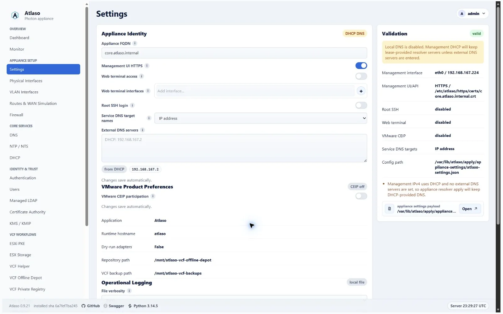
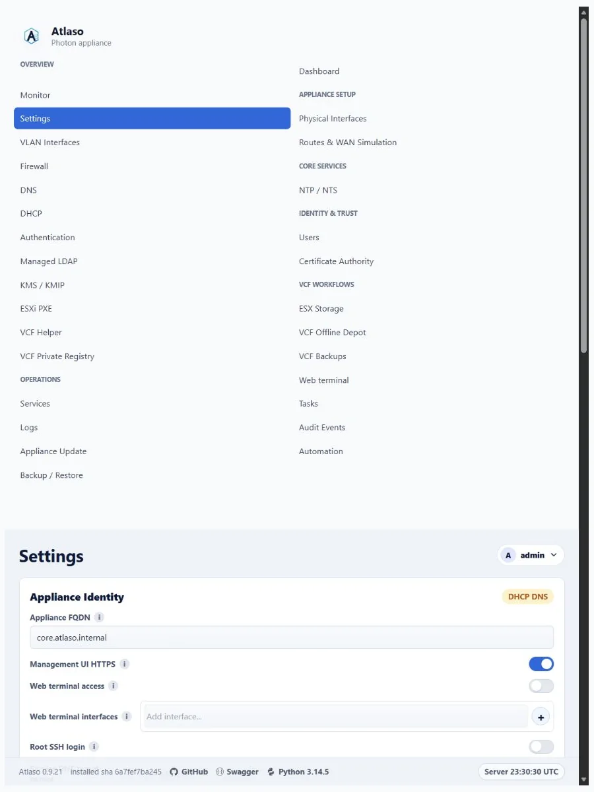
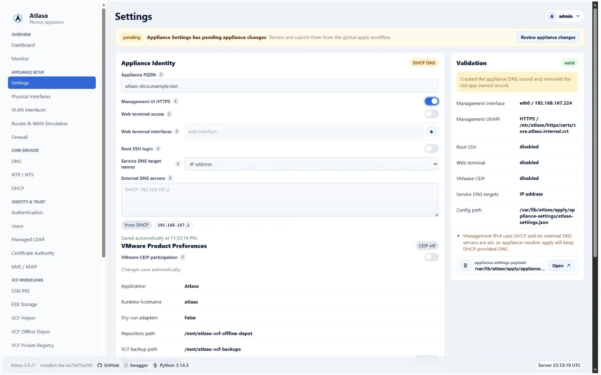
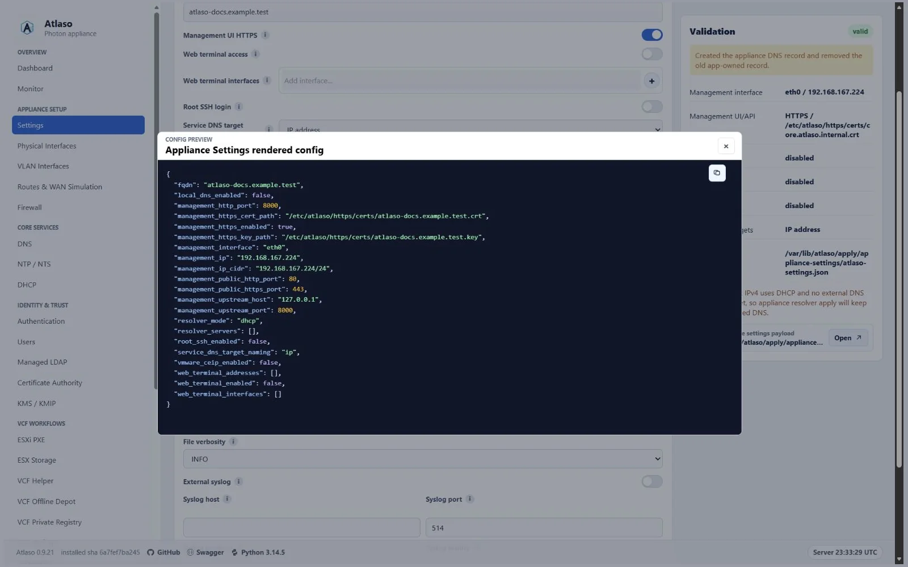
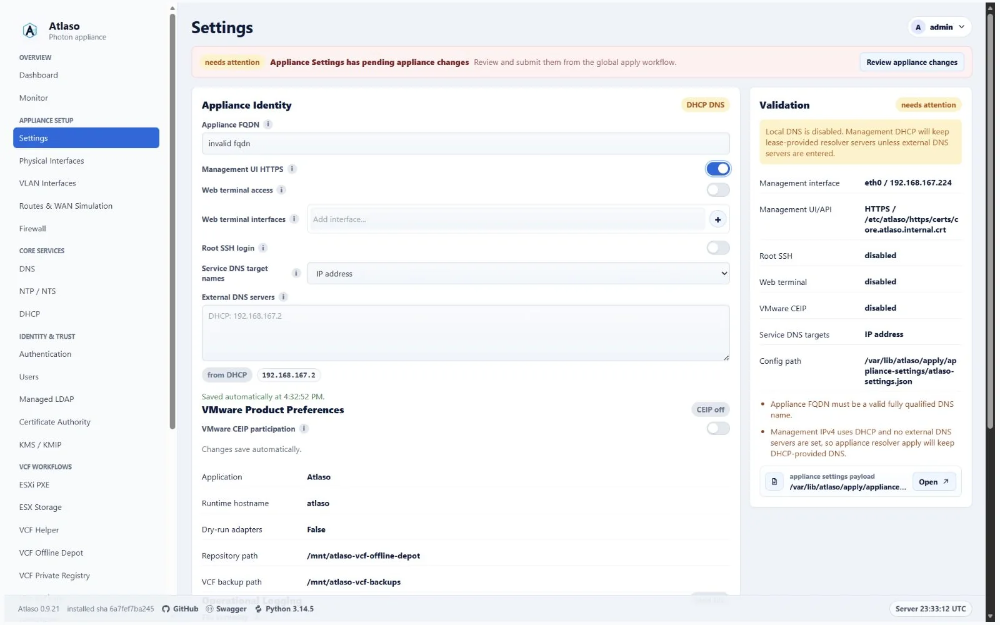

# Appliance settings

Open **Settings** and choose the tab for the information or control you need. The page groups settings into **General**,
**Access & Security**, **Hardware**, and **Logging**. Existing identity, resolver, access, authentication, product
preference, and logging forms keep their current save behavior. Appliance changes that affect host services still wait
for the global Appliance Apply workflow; immediate application settings and explicit maintenance tasks are labeled at
the point of action.

<!-- BEGIN GENERATED INTERFACE OVERVIEW -->
## Interface overview

This verified appliance view provides visual orientation before you begin.

*Figure: Settings in the verified clean-appliance desktop state.*

<!-- END GENERATED INTERFACE OVERVIEW -->

Atlaso retires Photon's unchanged nginx HTTP welcome server when preparing the
management front door, including on appliances upgraded from an older image.
This keeps the scoped management and Public Services listeners able to start
after a reboot. Custom nginx virtual hosts are preserved; remove conflicting
custom wildcard listeners before applying a management-listener change.
After an upgrade, the installed service-start guard performs the same cleanup
before nginx opens its sockets, including during unfinished release recovery.
Original configuration bytes are retained in root-only, content-addressed backups
under `/var/lib/atlaso/update-backups/nginx-stock-listeners/` before cleanup.
The vendor-listener repair persists across release rollback while existing
maintenance guards keep the front door closed until recovery completes.
A failed nginx configuration check blocks startup and restores the configuration
from before cleanup.

## Configure authentication lifetimes

On **Access & Security**, **Authentication lifetimes** saves immediately and does not create a pending Appliance Apply unit:

- **Browser session inactivity timeout** defaults to 30 minutes and accepts 5 through 1,440 minutes. Atlaso evaluates
  the current value before every protected browser handler, so lowering it can expire an existing inactive session on
  its next request. Raising it does not resurrect a session that already expired.
- **Maximum API token lifetime** defaults to 90 days and accepts 1 through 365 days. It applies only when a new token is
  issued. An omitted expiry uses the configured maximum; an explicit timezone-aware future expiry may be shorter.
  Existing token expiry timestamps remain unchanged.

Atlaso stores browser activity server-side. Full-page navigation, submitted forms, deliberate browser actions, and the
CSRF-protected activity heartbeat extend the timeout. Static assets, background status polling, and passive page
refresh requests do not. At the exact inactivity boundary Atlaso invalidates the session before the protected handler,
clears browser identity and CSRF state, records a sanitized audit event, and returns `401` to fetch/API consumers. Human
navigation returns to the appropriate management, public, or protocol login surface with **Session expired due to
inactivity**.

This also applies to management navigation and reloads controlled by the installed service worker. Background
fetches and API clients retain structured errors. If an old sign-in form has stale CSRF state, Atlaso rejects that
submission and opens a fresh form with **Sign-in form expired. Please sign in again.** Enter the credentials again;
the rejected submission is never replayed. Permission-denied responses remain permission failures.

The authenticated VCF Offline Depot browser sends deliberate `/PROD/` activity through its depot protocol listener;
it does not require or publish the management UI plane on that interface.

The OIDC provider applies the same timeout to its separate `/identity` browser session. Its signed cookie carries only
an opaque session identifier; Atlaso persists the authoritative activity and terminal-expiry state. A successful
credential submission starts the session, while silent `prompt=none` authorization does not refresh it. Once the
deadline is reached, silent authorization returns `login_required`, and raising the policy cannot resurrect that
expired session; a new interactive sign-in is required.

Settings archives preserve both policy values but exclude active browser-session records. Factory reset restores the
30-minute and 90-day defaults and invalidates all earlier sessions and tokens.

## Inspect hardware and guest tools

The **Hardware** tab reports the detected virtualization platform, manufacturer and model when firmware provides
them, CPU architecture and model, processor count, memory, and read-only disk and network-adapter inventories. An
inventory error is shown separately from a successful check that found no devices. Hardware inventory never claims or
changes a disk, NIC, mount, or interface configuration.

The guest-tools section recommends only the integration compatible with the detected VMware, Hyper-V, or KVM/QEMU
platform; Proxmox uses the QEMU guest agent. Each check reports the detected provider, package version and state,
effective service state, supported components, payload availability, clock-safety status, and any reboot impact. A
provider check is observational and does not install or start software. The page distinguishes a missing package, an
installed but stopped service, a healthy service, an unsupported environment, and an unknown result when observation
failed. Bare-metal appliances do not require a guest agent.

When the compatible verified offline package closure is available, an administrator can review its package and
service plan and explicitly queue installation or repair. Package maintenance runs as a serialized, audited background
task; follow its progress and final result in Tasks. Repeat the check after an interrupted or partial failure. A
successful package command alone does not prove the service is healthy. The task preserves the appliance's selected
clock authority; it does not introduce another time-source setting. See [Appliance time source](../services/ntp.md#appliance-clock-source).

New appliance builds retain verified VMware, Hyper-V, and QEMU guest-tools closures under
`/var/lib/atlaso-privileged/guest-tools` for this workflow. Existing installations may not have those closures,
especially after a
portable first-boot selection has securely removed its separate temporary package staging. In that case Settings shows
the supported compatible-payload prerequisite and does not download from arbitrary repositories or fall back to
unreviewed network installation. Continue with the documented supported source or a compatible appliance image that
carries the verified closure; checking and opening Hardware remain safe without it.

Hyper-V reports only the supported Linux integration components. KVP and VSS are supported; the legacy file-copy
daemon uses a transport absent from Atlaso's supported Linux 6.12 kernel. QEMU guest-agent host communication requires
the guest channel expected by the hypervisor. A host must expose that channel before the guest service can become
healthy. See the [virtualization artifact guide](../reference/virtualization-artifacts.md#operator-managed-guest-tools)
for provider details and limitations.
During the first upgrade that introduces the persisted token policy, Atlaso migrates a valid legacy
`ATLASO_API_TOKEN_TTL_DAYS` value instead of silently replacing it with the 90-day default. Subsequent startups retain
the database policy, so removing or changing that legacy environment variable does not overwrite operator state.

## Before you begin

Confirm the intended management hostname and DNS records. Keep an alternate console session available before changing
management connectivity or SSH policy. Routine field changes autosave, but they do not change the host immediately.

## Edit and validate

1. Change only the desired-state fields required for the maintenance window. Authentication lifetime fields use their
   separate immediate autosave boundary described above.
2. Watch the compact autosave status.
3. Resolve errors or warnings in the Validation card.
4. Open the rendered preview and confirm the hostname, resolver, HTTPS, and SSH effects.
5. Open **Pending Appliance Changes** and submit the valid Appliance Settings unit.

The review modal may include other changed units. Unselect unrelated work before submission.

Changing the domain portion of the appliance FQDN also reconciles factory-derived service identities. Atlaso derives
each factory hostname from the new appliance domain, updates coupled OIDC issuer and managed-certificate desired state,
and safely refreshes app-owned DNS aliases. Explicitly customized service hostnames and operator-owned DNS records are
preserved. Review every affected service, Certificate Authority, DNS/DHCP, Firewall, and Public Services unit shown as
pending; autosave changes desired state but does not apply those units to the host.

The root SSH preference controls whether the root account may log in remotely; it does not control ordinary
bootstrap-administrator SSH. Firewall admission for that administrator follows the effective management listener,
including a flagged access physical interface or VLAN, while unflagged access networks remain closed on TCP/22.

## Verify and recover

After the task succeeds, confirm the expected management URL and resolver behavior. If management access is lost, use
the [local appliance console](appliance-console.md) to inspect networking and restore a known-good configuration.

<!-- BEGIN GENERATED ADDITIONAL SCREENSHOTS -->
## Additional verified states

These captures show responsive layouts and useful operational states referenced by this page.

### Appliance Settings

*Figure: Settings in the verified clean-appliance responsive state.*

*Figure: Valid Appliance Settings waiting for global appliance apply.*

*Figure: Rendered Appliance Settings configuration preview.*

*Figure: Appliance Settings validation error for an invalid FQDN.*

<!-- END GENERATED ADDITIONAL SCREENSHOTS -->
