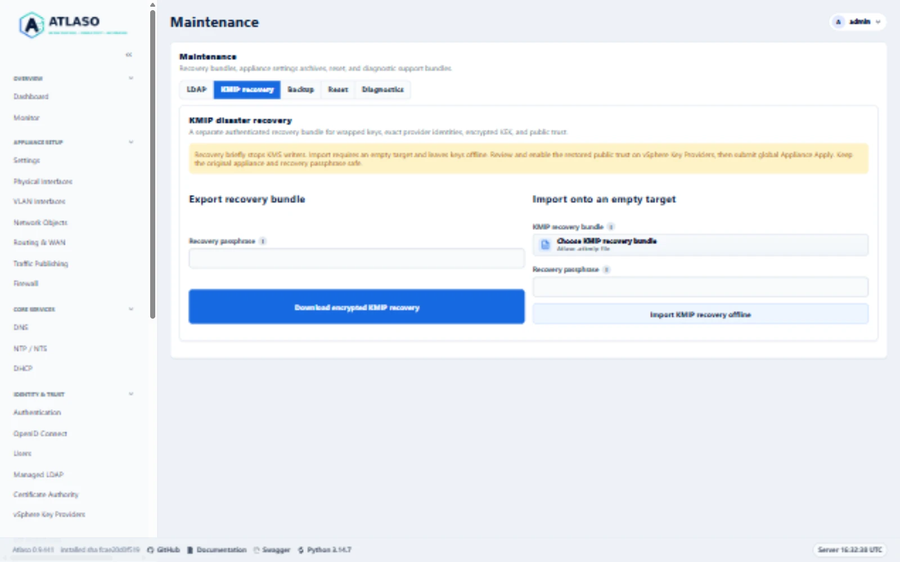
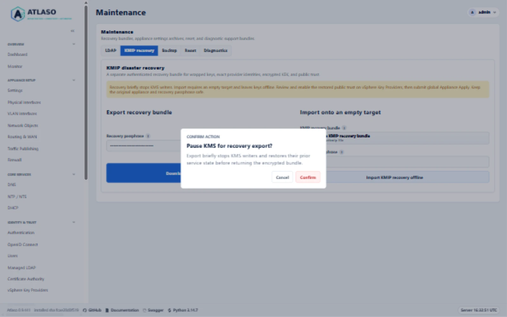
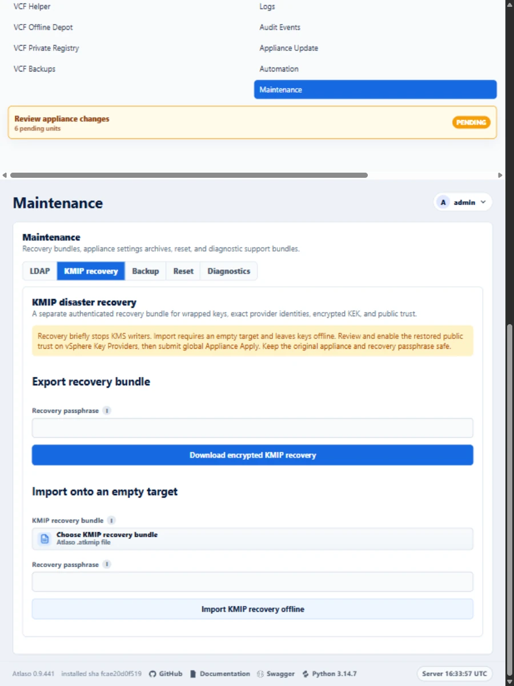

# KMIP disaster recovery

Use **Maintenance > KMIP recovery** to preserve operational key custody separately from the settings archive.
Keep the original appliance and its storage intact throughout recovery. Recovery is an experimental VCF 9.1 capability;
the implemented archive contract does not establish an encrypted-workload support matrix.

<!-- BEGIN GENERATED INTERFACE OVERVIEW -->
## Interface overview

This verified appliance view provides visual orientation before you begin.

*Figure: KMIP recovery forms and empty-target guidance on the documentation appliance in the desktop viewport.*

<!-- END GENERATED INTERFACE OVERVIEW -->

## Before exporting

1. Complete the existing provider and public-client trust configuration through global **Appliance Apply**.
2. Arrange a maintenance window: export briefly stops both KMS writers and restores their previous service posture.
3. Create a strong recovery passphrase in your organization's secret manager. Keep it separately from the bundle.
   Atlaso never retains the passphrase and cannot recover a lost one.
4. Download a separate settings archive for appliance/network desired state. It does not contain operational keys.

## Export an authenticated bundle

Open **Maintenance > KMIP recovery**, enter the recovery passphrase, and select **Download encrypted KMIP recovery**.
Confirm the service pause. Store the downloaded `.atkmip` file in protected backup storage.

The versioned bundle authenticates its complete contents using AES-256-GCM and a fixed-cost scrypt-derived key.
It contains exact provider/key identifiers, wrapped-key ciphertext and authenticated metadata, the original encrypted
KEK envelope, protected master custody, and public provider/vCenter/certificate relationships. No client private key is
collected. No plaintext operational key is returned through the management UI or API.

An export succeeds only after the helper restores the prior KMS service state. A failure requires checking service
health before retrying. Retain older verified bundles until the replacement has been independently tested.

## Restore onto an empty target

1. Prepare a separate appliance. Preserve the source appliance and every provider/key record. Do not reset or delete
   the source store to simulate appliance loss.
2. Restore appropriate appliance settings separately, then configure the target's management reachability, clock
   authority, and server certificate through their supported workflows. Avoid restoring unrelated provider/trust
   records before the KMIP import: its target must be empty.
3. Open **Maintenance > KMIP recovery**. Select the `.atkmip` bundle, enter its passphrase, and confirm
   **Import KMIP recovery offline**.
4. Atlaso authenticates and validates the complete candidate before publication. Nonempty native or legacy stores,
   wrong passphrases, corruption, unsupported schemas, duplicate identifiers, incomplete trust, and inconsistent KEK
   custody fail closed. Existing keys are never migrated or regenerated.
5. Imported provider/vCenter records are disabled and have no applied baseline. The listener remains offline.
   On **vSphere Key Providers**, review the restored provider UUIDs and exact public-client fingerprints against
   independent records. Enable only the reviewed original relationships. Expired certificates remain preserved as
   evidence and do not become valid because of import.
6. Review and submit global **Appliance Apply**. The helper requires the original enabled provider/fingerprint graph
   and binds startup authorization to the exact installed configuration and imported store identity. It retains the
   pending journal through listener stability verification.
7. Re-establish the server's public trust on vCenter as required by its KMS trust mode. Verify KMS connectivity and
   authenticated lifecycle evidence. Independently verify access to a workload encrypted before the export before
   retiring any original appliance or backup.

The restore changes the target's wrapping-master custody to work with that target's appliance credential while
preserving the original wrapped-key rows and encrypted KEK bytes. It does not require copying the source appliance's
application secret.

## Interrupted import and rollback

The root-owned `/var/lib/atlaso-kmip-recovery` anchor retains a durable pending journal, private candidate, and the
previous empty directory. Active publication uses an atomic rename that refuses to replace a concurrent entry.
A late write causes rejection and restoration of the prior directory; it never overwrites the late key.
A validation failure before the pending journal is published removes only the newly prepared candidate.
A published journal retains its candidate for retry, including when the journal flush reports an error.

Retry an interrupted import with the **same bundle and passphrase**. If operational publication completed but the
application database transaction did not, that retry persists the public trust while retaining offline key custody.
A different bundle, changed identity, ambiguous filesystem state, unresolved SQLite journal, or conflicting target
requires maintainer reconciliation. Preserve the journal, candidate, and previous directory. Do not manually remove,
rename, edit, or reconstruct store files to clear a gate. Do not expose their contents in logs or support reports.

An ordinary Apply failure uses the existing KMS cutover rollback procedure. An incomplete import remains offline;
do not force-start it or replace its pending marker. Keep the original appliance available throughout recovery.

Complete **Factory reset** deliberately removes both active KMIP state and all retained recovery custody, including
pending markers, checkpoints, private candidates, and previous directories. It does not preserve an appliance-local
recovery copy. Verify an independently stored bundle before choosing reset; interrupted cleanup must resume through
the existing protected reset workflow.

## Legacy PyKMIP transition

Native startup, KMS Apply, and candidate release admission require read-only legacy emptiness evidence. Atlaso checks
the configured database and retained files under `/var/lib/atlaso/kms`, including unresolved journals. Missing configured
files, corrupt databases, unknown retained material, or any application row block replacement unchanged.

A nonempty legacy store requires a **new appliance and VMware-supported rekeying**. There is no in-place key migration,
regeneration, forced admission, or supported procedure for manually clearing the store.

For a demonstrably empty legacy store, stop the old listener through the appliance's supported systemd service
procedure before release admission. KMS Apply captures the prior service posture, stops the old writer, and repeats
the emptiness proof immediately before admitting the replacement. A failed cutover restores the prior service state.
Disabled Apply also requires the old writer already stopped; it must not discard an active legacy listener.

## API and evidence

Both API operations require `write:kms`:

- `POST /api/v1/vsphere-key-providers/recovery/export` accepts a request-bound passphrase and returns encrypted binary.
- `POST /api/v1/vsphere-key-providers/recovery/import` accepts the passphrase and base64-encoded encrypted archive and
  returns `pending-trust-review`. Review and global Apply remain required.

The decoded bundle limit is 32 MiB. Successful exports disable caching. Audits contain only operation/status context,
never passphrases, master custody, wrapped-key bodies, or decrypted operational keys.

For [issue #172](https://github.com/mdaneri/Atlaso/issues/172), the maintainer explicitly waived agent-run ESXi encrypted
workload tests and will perform them separately in production. This waives that agent-delivery gate only. No production
access, deployment, mutation, or workload test is authorized for the agent. Encrypted-VM, vSAN, and restored-workload
access are **not reported as passed**; support remains limited to the matrix actually observed. Security and
disaster-recovery review, local correctness checks, and recovery safety remain required.

<!-- BEGIN GENERATED ADDITIONAL SCREENSHOTS -->
## Additional verified states

These captures show responsive layouts and useful operational states referenced by this page.

### Backup and restore

*Figure: Review the brief KMS writer pause before export. This documentation preview was canceled without creating an archive.*

*Figure: KMIP recovery forms and empty-target guidance on the documentation appliance in the responsive viewport.*

<!-- END GENERATED ADDITIONAL SCREENSHOTS -->
