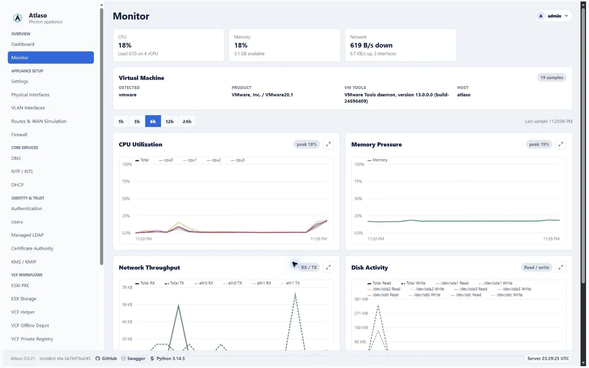
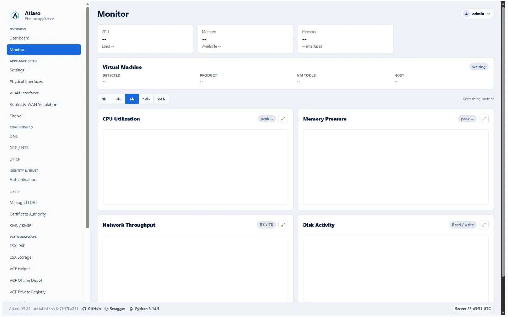
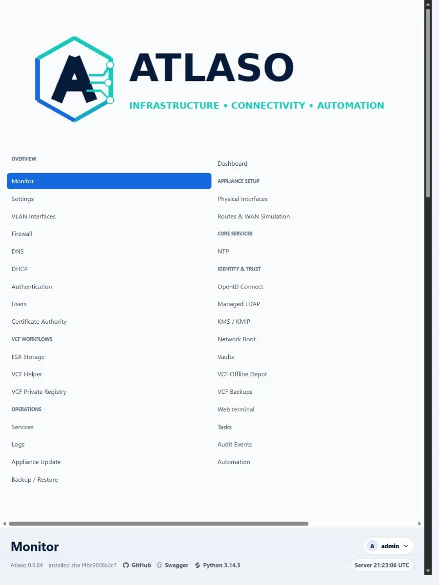
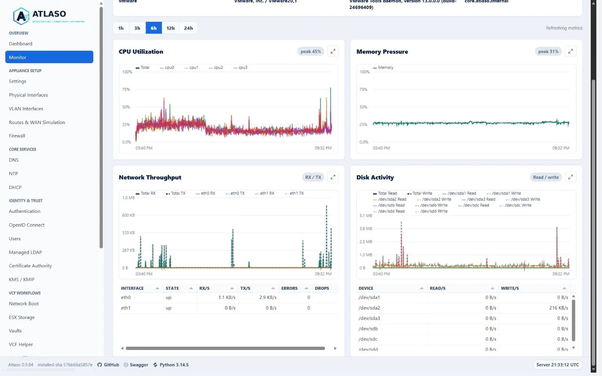
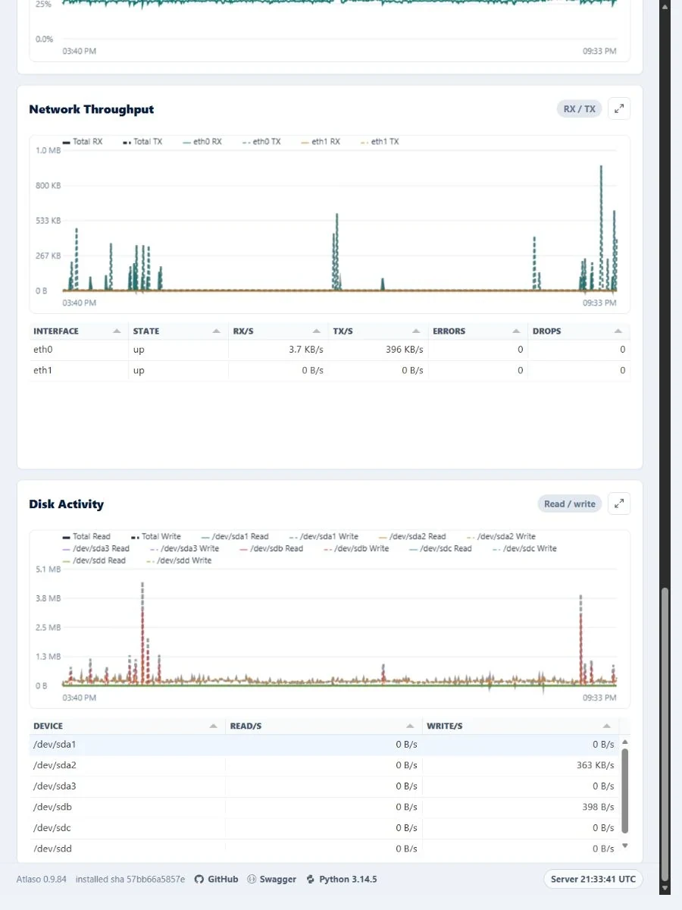

# Monitor appliance health

Open **Monitor** for a read-only view of appliance runtime health. **Overview** reports CPU, memory pressure, network
throughput, unique-device disk activity, interface state, and virtual-machine context. **Network** shows live routes,
policy rules, interfaces, forwarding, gateway neighbors, and a kernel route lookup. **Services & Clock** reports
observed service state, restart counts, verified listener addresses, and the effective clock source.

<!-- BEGIN GENERATED INTERFACE OVERVIEW -->
## Interface overview

This verified appliance view provides visual orientation before you begin.

*Figure: Monitor summary and live charts in the verified desktop state.*

<!-- END GENERATED INTERFACE OVERVIEW -->

When you reopen **Monitor** from the sidebar, it restores your last available tab in the same browser.
Links to a specific Monitor view open that view.

Select **Network Diagnostics** beside **Route lookup** when you need to send a probe from the appliance. Administrators
and Network Administrators can also open [Network Diagnostics](network-diagnostics.md) from **Operations**.

## Read the charts

Use **Overview**, **Network**, and **Services & Clock** to switch between the time-series charts and live runtime
observations. Each runtime view loads when opened. Choose **Refresh** to request a new observation. The capture time
shows when the observation was taken. Partial or unavailable sections remain labeled so missing data is not read as an
empty route table or healthy service.

- Start with the appliance totals before expanding per-CPU, per-interface, or per-device series.
- Use the common time-range selector to compare the same interval across charts.
- A range selected during a refresh is loaded next. Rapid changes coalesce to the latest selection, and Atlaso does not
  render an older range beneath the newly active control.
- Expand a chart when series overlap; full-screen zoom does not change the selected history range.
- Use the read-only interface and device grids below Network Throughput and Disk Activity for the latest per-resource
  values. Live refresh replaces grid data in place so sorting and scroll context remain stable.
- Treat unexpectedly down configured physical interfaces as actionable. Disabled optional services and unused
  interfaces are not exceptions.

## Inspect routing and services

The Network view lists IPv4 and IPv6 routes from every observed kernel table and policy rules in priority order. Table
`100` is labeled **Management** and table `200` **Lab**, with the native table numbers retained. Use the route filter
to narrow the grid by family, table, or interface. The interface and address grid reports observed carrier, MTU,
effective addresses and address origin alongside receive and transmit errors. IPv4 and IPv6 forwarding state is shown
separately. Gateway neighbors are observed from the current kernel table, without sending probes. **Route lookup**
uses the entered destination and optional source and ingress interface to ask which route the kernel would select. It
sends no packets and reports route selection, not reachability.

When opened from a completed Appliance Update task, Monitor also compares captured routes, policy rules, interface
addresses, and forwarding before and after that update. Capture times are shown for each phase. Partial observations
identify the affected section, and updates created before snapshot support show **No comparison recorded**. Live
neighbor state, interface counters, and route lookups are not historical update data.

Services & Clock reports service state, activation age, restart count, and listener addresses when the appliance can
verify socket ownership. A missing or unverifiable listener observation is labeled **Unavailable**. The clock summary
uses the same verified time-source and synchronization status as **Settings → Time**, including pending or unverified
state. Open the owning settings link to review desired service state.

Filesystem-capacity charts are intentionally not part of this page. Disk activity is counted once per underlying
device, even when a filesystem is visible through multiple mount paths. The initial server snapshot also populates the
accessible fallback tables when browser scripting is unavailable.

## Verify an exception

Compare interface exceptions with [Network configuration](networking.md), service health with the owning service guide,
and recent failures with [Tasks](tasks.md). Monitor is read-only; make changes through the owning desired-state workflow
and use [Appliance Apply](appliance-apply.md) for enforcement.

<!-- BEGIN GENERATED ADDITIONAL SCREENSHOTS -->
## Additional verified states

These captures show responsive layouts and useful operational states referenced by this page.

### Monitor

*Figure: Runtime monitoring after a successful appliance apply.*

*Figure: Monitor summary and live charts in the verified narrow state.*

*Figure: Network-interface and disk-device activity use read-only grids beneath their live charts.*

*Figure: Network-interface and disk-device grids remain readable without page overflow in the narrow viewport.*

<!-- END GENERATED ADDITIONAL SCREENSHOTS -->
