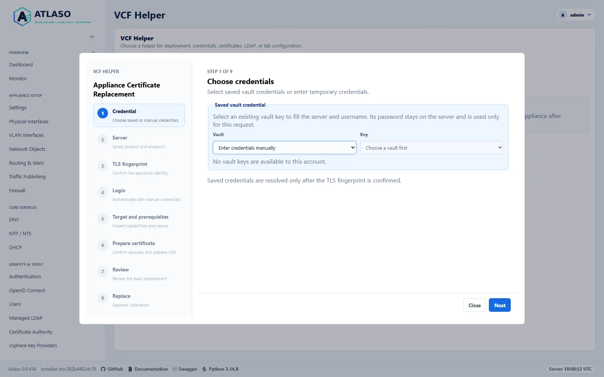
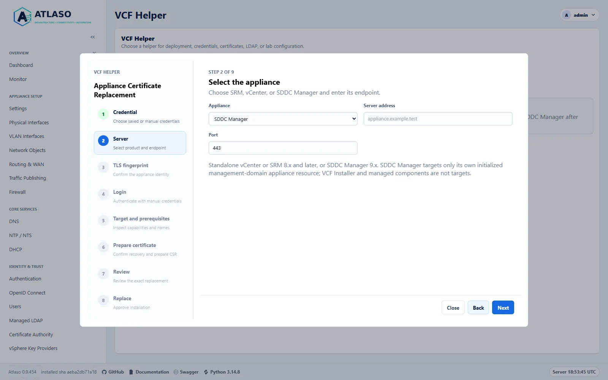
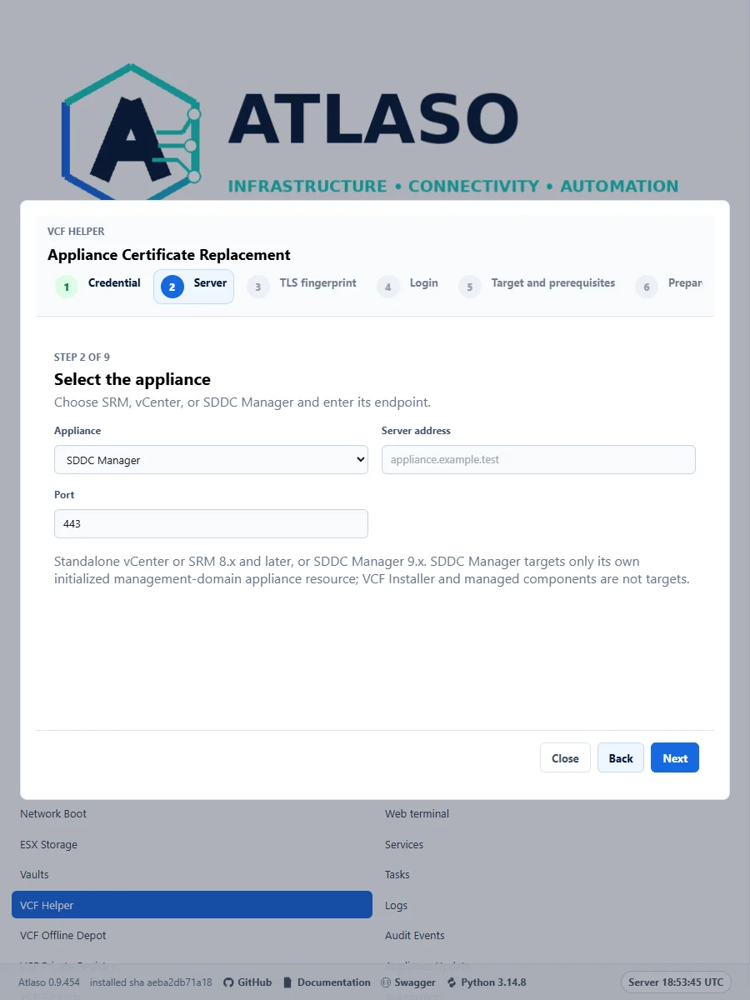
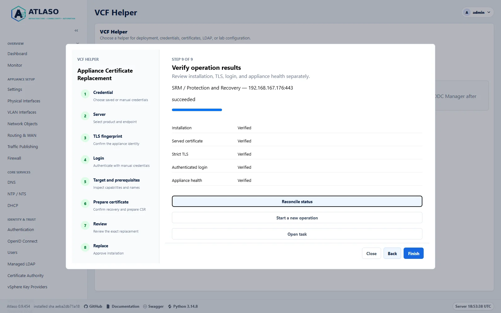
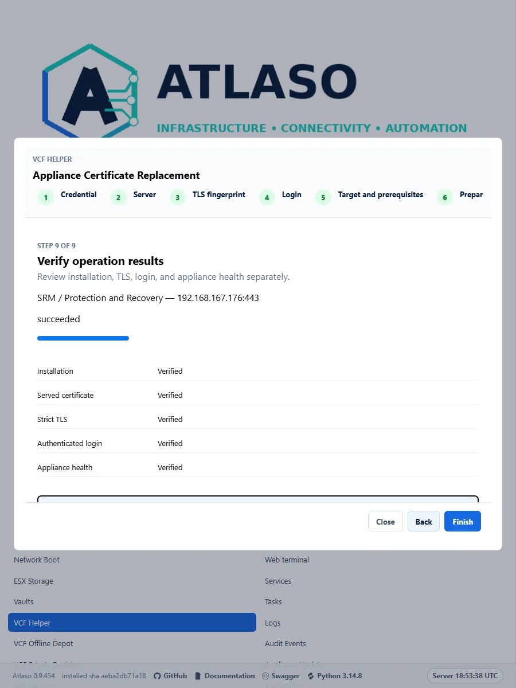
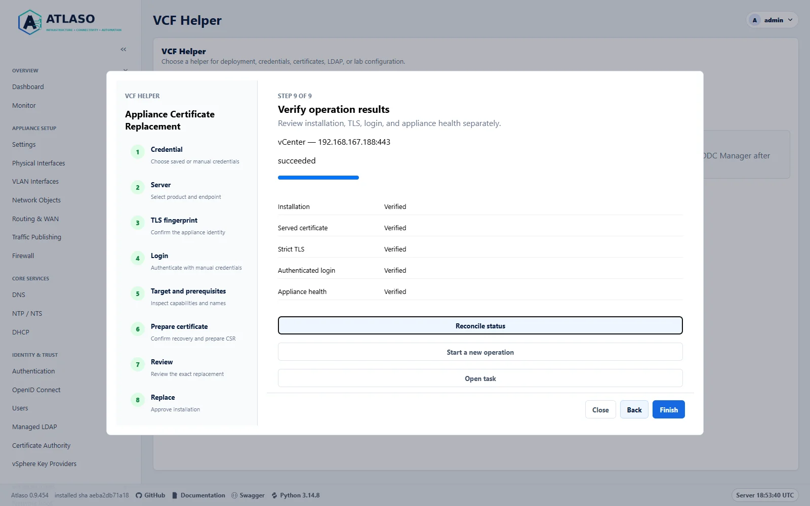
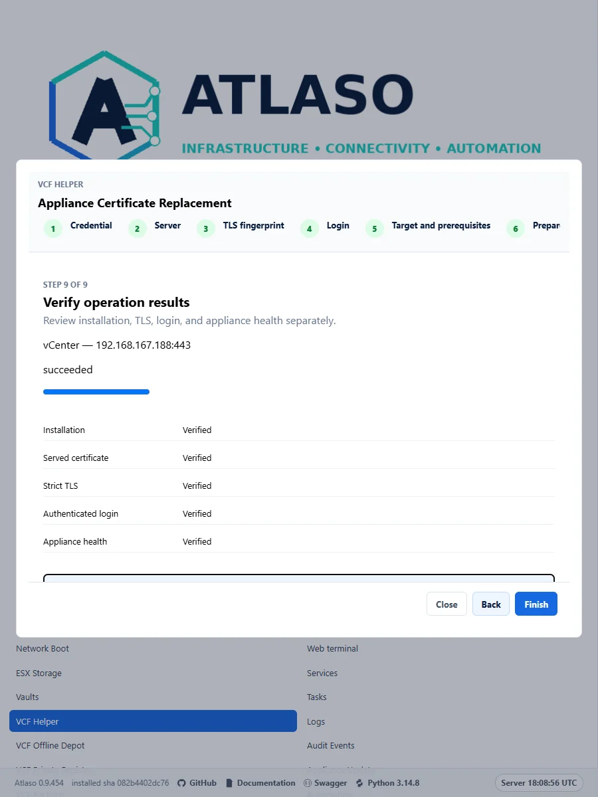
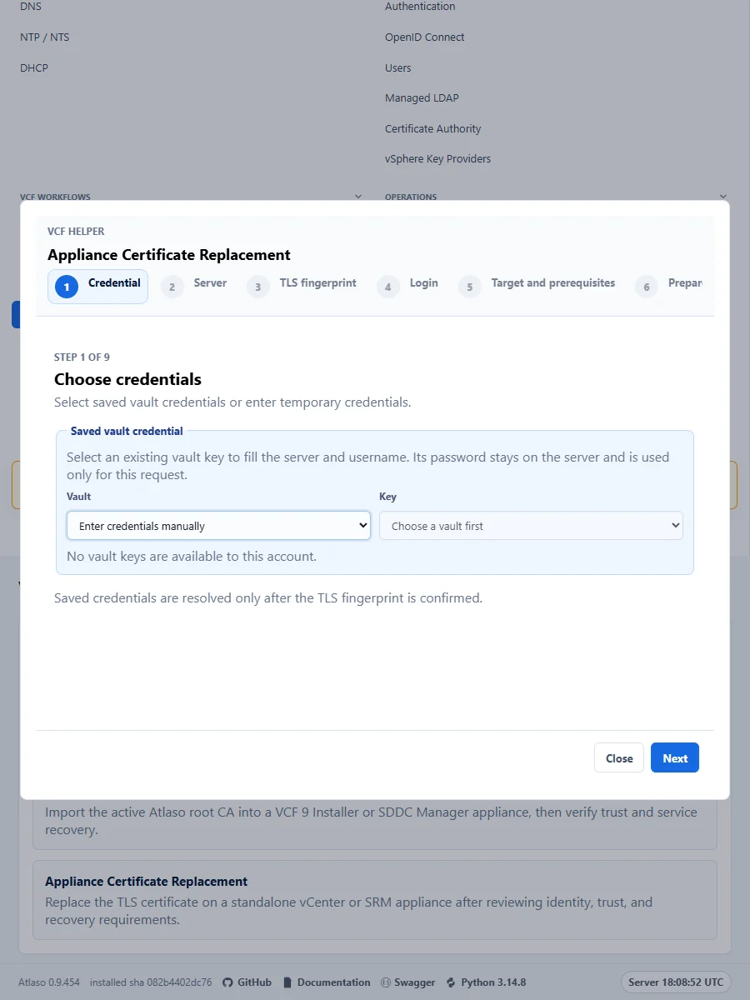

# Appliance certificates with Atlaso

## Atlaso Appliance Certificate Replacement

<!-- BEGIN GENERATED INTERFACE OVERVIEW -->
## Interface overview

This verified appliance view provides visual orientation before you begin.



*Figure: Choose a saved vault credential or request-local manual login before confirming target TLS identity.*

<!-- END GENERATED INTERFACE OVERVIEW -->

VCF Helper automates the native CSR, Atlaso issuance, and replacement path for standalone vCenter and unregistered
standalone SRM / Protection and Recovery appliances running 8.x or later, subject to native capability checks.
vCenter HA, linked vCenters, registered SRM, and unknown topology are blocked for coordinated vendor workflows.
The wizard also supports the SDDC Manager appliance resource in an initialized 9.x management domain. Unit contracts
cover the supported version families;
native appliance validation was performed on 9.1.1 builds only. Do not infer native 8.x acceptance from unit tests.

The **Certificates → Appliance Certificate Replacement** wizard uses this sequence: credential source, product and
server, certificate fingerprint confirmation, manual login when needed, target/prerequisite inspection, explicit
preparation acknowledgement, reviewed certificate and recovery plan, explicit replacement approval, and task results.
Saved vault credentials are resolved server-side only after TLS identity confirmation; manual credentials are
request-local. A change to target, credential, or fingerprint invalidates the review and prepared client state. Any
existing operation must be reconciled before starting another.

SAN values begin from the current certificate and native appliance identity. SRM's common name and hostname SAN use
the configured native hostname; placeholder `localhost` and loopback SAN values are removed while valid existing
names are retained. For vCenter, the native PNID is used; an IP PNID must appear in both DNS and IP SAN sets. Review
the final SAN list carefully before preparation. The wizard requires an already-ready Atlaso CA and enabled profiles
with exact usages: SRM requires RSA 2048 and `digitalSignature,keyEncipherment,dataEncipherment` with
`serverAuth,clientAuth`; vCenter requires RSA 2048, 3072, or 4096 and `digitalSignature,keyEncipherment` with
`serverAuth`. Shared CA profiles are not weakened to meet a target.

The appliance generates and retains its private key. Atlaso stores only public certificate material, credential
references, and operation checkpoints. Review tokens are single-use, bound to the administrator, and expire after
ten minutes. Native requests are bounded to 30 seconds; readiness verification is bounded to 15 minutes. An
uncertain write keeps its target reservation until reconciliation establishes the outcome. Never regenerate a
possibly pending CSR or repeat a possibly completed installation. Use the task's **Reconcile status** action and the
vendor recovery reference.

Settings restore preserves this appliance's certificate checkpoints and target reservations; they are not exported
in settings archives. After a restart, interrupted jobs require reconciliation. If operation records are missing or
damaged, Atlaso marks the job failed without releasing surviving reservations; inspect native state and task history
before retrying.
Concurrent review or reconciliation requests cannot overwrite newer checkpoints or release their reservations.
If another request advances the operation, read its current status before retrying.
If a saved operation is missing or belongs to another administrator, **Forget inaccessible reference** clears only
this browser's reference. Its durable task and target reservations remain unchanged; temporary outages retain the reference.

Use Atlaso as the issuing CA while the target appliance generates its own certificate signing request (CSR) and keeps
its private key. Install the signed leaf certificate and public CA chain through the target's native administration
workflow. Start with [Certificate Authority](certificate-authority.md) for CA configuration and access.

## Choose the certificate and trust operation

| Operation | Material and destination |
| --- | --- |
| Replace SRM appliance TLS | SRM-generated CSR, signed leaf, and CA chain in the SRM certificate installer |
| Replace SDDC Manager TLS | SDDC Manager-generated CSR, signed leaf, and public CA chain for its own resource |
| Replace vCenter Machine SSL | vCenter-generated CSR, signed leaf, and trusted root chain in Certificate Management |
| Trust the server from a browser or API client | Verified public Atlaso root in that client's trusted CA store |
| Trust another server from an appliance | Verified public CA certificates in the appliance's supported outbound trust store |
| Trust Atlaso from VCF Installer or SDDC Manager | Use the separate [VCF Certificate Trust](vcf-trust.md) workflow |
| Enroll a KMIP client | Follow [vSphere Key Providers](vsphere-key-providers.md), which has different certificate purposes |

**Include the public Atlaso root in the appliance's CA-chain input.** If the root signs the leaf directly, the chain
contains that root alone. With intermediate issuers, include the intermediates in issuer order, ending with the root.
Keep the leaf separate when the installer has separate leaf and chain fields. Installing a chain does not establish
trust in every browser, peer appliance, or outbound trust store; configure each relying party separately.

Download **Download root CA** from the Atlaso CA page and verify its SHA-256 fingerprint through an independently
trusted record or appliance console before trusting it. Distribute only public certificates. The root private key
stays in Atlaso; the target private key stays in the target appliance for the CSR workflows below.

The CA can issue and apply certificates with **Listen interfaces** empty. Select an eligible access interface only
when you intend to publish its public certificate portal on that network. DNS listening is a separate service
configuration; the dedicated management role is reserved for the management UI.

## Prepare the target

1. Record the exact product/version, certificate role, target VM identity, current certificate fingerprint, and
   recovery procedure. Schedule any required maintenance and preserve the vendor-supported backup or rollback point.
2. Configure a proper appliance FQDN before requesting a certificate, for example `srm.lab.example` or
   `vcenter.lab.example`. Confirm forward DNS, any vendor-required reverse DNS, and resolution from the appliance and
   its clients. Do not use a factory `localhost.localdomain` identity for deployment.
3. Record the exact names clients use. Include each required DNS name as a DNS SAN; include an address as an IP SAN
   only when clients connect by that address. An IP in Common Name or a DNS SAN does not replace an IP SAN.
4. With DHCP, arrange an address reservation or managed DNS updates before relying on a persistent address. If the
   address changes, update DNS and replace any certificate whose IP SAN no longer matches.
5. Verify current time on Atlaso and the target. Follow [NTP and NTS](ntp.md); keep the intended clock source rather
   than enabling both NTPsec and VMware Tools clock synchronization.
6. Verify the target's existing TLS identity before sending administrator credentials. For a factory certificate,
   establish its fingerprint through the verified appliance console or another independent trusted observation.
   Never substitute disabled TLS verification for identity confirmation.

Renaming a registered appliance may affect service registration and site pairing. Follow the version-matched vendor
rename procedure first; issuing a certificate with a new name does not rename the operating system or update DNS.

## Issue an appliance CSR through Atlaso

1. Generate the CSR in the target appliance. Save the public PEM CSR and keep the corresponding private key there.
   Do not generate another CSR before installing the response: that can replace the key associated with the request.
2. In **Certificate Authority → Profiles**, select a suitable enabled server profile or create a dedicated profile
   with **+ Add profile here**. Match the vendor's algorithm, validity, key usage, extended key usage (EKU), and SAN
   requirements. Avoid changing a shared profile to satisfy one appliance.
3. Open **CSR Intake → Start CSR intake**. Enter the common name, profile, description, DNS SANs and IP SANs, then
   paste the complete PEM CSR or select **Upload a CSR file** for a PEM-encoded `.csr` or `.pem` file up to 64 KiB.
   Review the populated CSR and identity, then select **Stage CSR request**. Confirm control of every SAN;
   the signed certificate's names must match the intended target, not merely the names an unverified CSR requests.
4. Open **Review appliance changes**. Select **Certificate Authority** and inspect any required dependencies.
   Deselect unrelated pending units. Submit the reviewed plan and confirm its task succeeded before installing.
5. In **Certificate Requests**, confirm the request is **issued**. Open its row menu and select
   **Export → Certificate**. Download the public root separately. Inspect any exported certificate chain before using
   it: an installer with separate inputs expects a leaf-only file and a CA-only chain file.
6. Check the signed leaf against the original CSR: public key, subject, DNS/IP SANs, validity, issuer, key usages,
   EKUs, and non-CA basic constraints. Verify its signature chain against the expected public root.

If a newly added profile is missing from the CSR wizard, cancel the blank wizard and reload the CA page before
starting intake again. Exporting a private key is unnecessary for an appliance-generated CSR.

### Understand the downloaded files

Atlaso's **Export → Certificate** downloads a PEM-encoded leaf named `<name>.pem`. Older Atlaso releases downloaded
the same PEM format with a `.crt` filename. PEM describes the encoding; a `.crt` extension alone does not mean the
contents are binary DER. A PEM certificate contains
`-----BEGIN CERTIFICATE-----` and `-----END CERTIFICATE-----` markers.

| Download | Filename | Contents |
| --- | --- | --- |
| **Export → Certificate** | `<name>.pem` | One PEM leaf certificate |
| **Export → Certificate chain** | `<name>-chain.pem` | PEM leaf followed by the Atlaso root for newly issued certificates |
| **Download root CA** | `atlaso-root-ca.pem` | Public PEM root certificate, without the leaf |
| **Download CA bundle** | `atlaso-ca-bundle.pem` | Public PEM root certificate in the current direct-root issuing model |
| **Export → Private key** | `<name>.key` | Separate PEM private key, available only when Atlaso generated and holds it |

For a CSR generated in SRM or vCenter, **Private key** is disabled because Atlaso does not have that key. Use the
target's signed-CSR response import option. These downloads are separate PEM artifacts, not a PKCS#12/PFX bundle.

For an older `.crt` download, if an import file picker requires `.pem`, save a copy of the already PEM-encoded file
with a `.pem` extension. No encoding conversion is needed. Renaming a file does not convert DER or PKCS#12 into PEM,
supply a missing private key, or change the certificate's usages.

For separate certificate and CA-chain inputs, use the leaf and **Download root CA** when Atlaso signs directly.
Do not put **Export → Certificate chain** into a CA-only field: that export includes the leaf. Choosing a PKCS#12
import option instead of a signed-CSR option also requires a different artifact; renaming `.crt` to `.p12` cannot
produce one.

For these OpenSSL examples, save the public CSR as `appliance.csr.pem` and the downloaded leaf as `appliance.pem`.
Keep the root's downloaded filename, `atlaso-root-ca.pem`. These commands inspect only public material:

```sh
openssl req -in appliance.csr.pem -noout -verify -text
openssl x509 -in appliance.pem -noout -text
openssl verify -CAfile atlaso-root-ca.pem appliance.pem
```

For an intermediate CA, supply its certificates with OpenSSL's `-untrusted` option when verifying the leaf. Compare
the CSR and leaf public keys as well as reading their subjects; matching names alone do not prove a key match.

## SRM and VCF Protection and Recovery

### Select a profile and generate the CSR

Create a dedicated **SRM Lab TLS** server profile: RSA 2048, 365-day validity, SAN required, key usage
`digitalSignature,keyEncipherment,dataEncipherment`, and EKUs `serverAuth,clientAuth`. Atlaso's default
**VCF service TLS** profile has `serverAuth` only. Confirm the full requirements for your product/version and
authentication mode against
[Broadcom's SRM/replication certificate guidance](https://knowledge.broadcom.com/external/article/375573).

The initial installation-only lab test omitted `dataEncipherment`; it did not validate certificate-based site pairing.
Include all three key usages when issuing a certificate for this workflow, and reissue an existing certificate that
lacks a required usage before attempting pairing. Do not treat successful certificate import as pairing acceptance.

Generate the CSR through the appliance's supported certificate administration workflow. For automation, the
[configuration API CSR operation](https://developer.broadcom.com/xapis/srm-appliance-config-api/latest/appliance/certificates/actions/generate-csr/post/)
generates the key inside the appliance. For example, the API base for `srm.lab.example` is
`https://srm.lab.example/api/rest/configure/v2`. On the tested Protection and Recovery 9.1.1 appliance, the
configuration API served port 443; port 5480 served the management UI.

Use the authenticated configuration API session mechanism documented for your version. Keep passwords and session
headers out of command arguments, URLs, saved request files, transcripts, and logs. The CSR input uses
`common_name`, `organization`, `organization_unit`, `country`, `fqdn` for DNS names, and `ip` for IP SANs. Use the
configured appliance identity and the verified address, for example `srm.lab.example` and `192.168.50.20`.

### Install and verify

1. Issue the CSR through Atlaso as described above, including the SRM-specific profile, all three key usages
   (`digitalSignature,keyEncipherment,dataEncipherment`), and both required EKUs (`serverAuth,clientAuth`).
2. Use the appliance's signed-CSR certificate import workflow. For the configuration API, send
   `POST /api/rest/configure/v2/appliance/certificates/server` with only the `csr_format` representation:

   ```json
   {
     "csr_format": {
       "certificate": "<signed leaf certificate PEM>",
       "ca_chain": ["<Atlaso root certificate PEM>"]
     }
   }
   ```

   Replace placeholders with PEM strings encoded by a JSON serializer. Include intermediate certificates if
   applicable. The [native certificate update operation](https://developer.broadcom.com/xapis/srm-appliance-config-api/latest/appliance/certificates/server/post/)
   returns HTTP 204 on success. No private key upload is needed because SRM owns the CSR key.
3. Wait for the appliance endpoints to become ready. Make fresh TLS connections to ports 443 and 5480, verify the
   exact new leaf fingerprint, and validate the chain and requested hostname against the expected Atlaso root.
4. Sign in again and check native appliance health and version. Reconfigure registration and reconnect the site
   pair when required by the vendor procedure; then check replication and the supported recovery test separately.

Do not assume every release accepts the same PKCS#12/PFX format. Broadcom documents version-specific limitations in
[SRM/VLSR/replication CA certificate configuration](https://knowledge.broadcom.com/external/article/422890/configuring-ca-signed-certificates-for-v.html).
Prefer the native CSR response path when the appliance generated the request.

If SRM must connect to a vCenter that now presents an Atlaso-signed Machine SSL certificate, its outbound trust must
also recognize that CA. This is distinct from installing SRM's own leaf and chain. Follow the version-matched
[SRM trusted-CA procedure](https://knowledge.broadcom.com/external/article/312683/srm-site-pairing-fails-with-unknown-ssl.html)
and verify registration/site pairing afterward; do not infer trust-store contents from a successful leaf import.

## vCenter Machine SSL

This section follows [Broadcom's vSphere Client procedure for vCenter 7.x, 8.x and 9.x](https://knowledge.broadcom.com/external/article/403973).
It replaces Machine SSL; changing the VMCA root is a separate operation. Verify requirements for your exact build.

For Machine SSL, use `serverAuth` as the EKU; do not reuse the SRM profile's dual-purpose EKUs. Broadcom specifies
an empty EKU or server authentication only for this role, while NSX cluster and some ESX client uses differ. See
[Broadcom's EKU requirements](https://knowledge.broadcom.com/external/article/434679/nsx-and-vcenter-server-machine-ssl-certi.html).
Atlaso's **VCF service TLS** profile supplies `serverAuth`; check its other settings against your version's requirements.

1. Prepare the supported backup and rollback point. For Enhanced Linked Mode, follow Broadcom's coordinated offline
   snapshot requirement for all linked vCenters. Disable vCenter HA as required by that procedure before rotation.
2. Confirm the FQDN matches the Primary Network Identifier (PNID), resolves correctly, and appears in the DNS SANs.
   Wildcards are unsupported.
3. As an authorized SSO certificate administrator, open **Administration → Certificate Management → Machine SSL**
   in the vSphere Client. Select the vCenter certificate and generate its CSR.
4. Submit that CSR through Atlaso with a profile satisfying the vCenter certificate requirements. Verify the issued
   certificate and preserve the vCenter-owned key.
5. Select **Import and Replace Certificate**, choosing the external CA option for a CSR generated by vCenter.
   This uses the private key retained inside vCenter. Supply only the leaf certificate and a separate trusted CA
   chain, including the
   Atlaso root. Complete the review and replacement.
6. Reconnect with strict TLS, verify the served leaf and administrator login, and check dependent services.

For native API automation, generate the request with
[`POST /api/vcenter/certificate-management/vcenter/tls-csr`](https://developer.broadcom.com/xapis/vsphere-automation-api/latest/api/vcenter/certificate-management/vcenter/tls-csr/post/).
Keep the returned CSR public and the generated private key inside vCenter. If Atlaso is not already trusted, import
its verified public root using
[`POST /api/vcenter/certificate-management/vcenter/trusted-root-chains`](https://developer.broadcom.com/xapis/vsphere-automation-api/latest/api/vcenter/certificate-management/vcenter/trusted-root-chains/post/)
with `{"cert_chain":{"cert_chain":["<Atlaso root PEM>"]}}`, then independently read back the stored root fingerprint.
For a vCenter-generated CSR and an already trusted issuer, replace Machine SSL using
[`PUT /api/vcenter/certificate-management/vcenter/tls`](https://developer.broadcom.com/xapis/vsphere-automation-api/latest/api/vcenter/certificate-management/vcenter/tls/put/)
with `{"cert":"<signed leaf PEM>"}`. The tested operation returned HTTP 204. Do not supply or export a private key
for this path. Reconnect afterward with the expected CA and exact new leaf fingerprint, then establish a fresh
administrator session and check appliance health.

In the tested IP-PNID lab, a certificate containing only the correct IP SAN was rejected with
`com.vmware.certificatemanagement.invalidargument.san.empty`. Issuing the same vCenter-owned CSR with its existing
PNID entered in both Atlaso's **DNS SANs** and **IP SANs** resolved that rejection. This is an observation for the
tested build, not a reason to replace a deployment's FQDN with an IP address. Prefer an established FQDN/PNID and
verify the actual issued SANs. Broadcom also documents
[SAN-empty import failures](https://knowledge.broadcom.com/external/article/416683/replace-cert-failed-subject-alternate-na.html).

Replacing vCenter Machine SSL can require SRM or replication reconfiguration and site reconnection. Follow
[Broadcom's recovery procedure after a vCenter SSL change](https://knowledge.broadcom.com/external/article/312784/site-recovery-manager-or-vsphere-replica.html).
Confirm outbound root trust on dependent appliances rather than accepting an unexpected fingerprint blindly.

## SDDC Manager 9.x

Use an initialized **SDDC Manager**, with an active management domain and its own certificate resource. VCF Installer
is a different appliance role and is not eligible. This workflow changes the SDDC Manager appliance certificate;
managed vCenter, NSX, ESXi, and other resource certificates require their own coordinated procedures.

1. Prepare a verified, supported SDDC Manager backup and recovery procedure and a maintenance window. Record the
   management-domain ID, SDDC Manager resource ID, native FQDN, and independently verified current TLS fingerprint.
   Check that the FQDN and every retained DNS SAN resolve to the appliance, its clock is correct, and native services
   are healthy. Use an explicitly assigned SDDC Manager administrator account; Atlaso does not infer inherited group
   permissions. Keep credentials in a vault or use the wizard's request-local login.
2. Open **VCF Helper → Certificates → Appliance Certificate Replacement** and select **SDDC Manager**. Confirm the
   exact TLS fingerprint before login. Inspect the target and select an existing ready Atlaso CA profile using RSA
   2048, 3072, or 4096, `digitalSignature,keyEncipherment`, and `serverAuth,clientAuth`. Review the discovered FQDN,
   SANs, management domain, and appliance resource. Correct native identity or DNS before continuing.
3. Acknowledge recovery readiness and that no external CSR or replacement is pending, then select **Prepare
   certificate** once. SDDC Manager creates the private key and CSR through its native domain-scoped task. Atlaso
   records the returned task ID, retrieves only that resource's public CSR, validates it, and issues through the
   selected profile. The private key remains on SDDC Manager.
4. Atlaso submits the issued leaf and public chain to native certificate validation. After it succeeds, build the
   final review and compare the current, replacement, and issuer fingerprints, exact resource and domain IDs,
   certificate names, validity, trust changes, interruption, and recovery reference. Approve **Replace certificate**
   only for those reviewed values. Atlaso records the native replacement task ID and verifies the result.
5. Check installation, exact served certificate, strict TLS, fresh authenticated login, native task completion,
   and service health separately. Validate browser and dependent-client trust using the reviewed public issuer.
   Certificate replacement alone does not establish fleet, workload, or lifecycle-operation acceptance.

The native APIs [generate a CSR][sddc-csr-put], [retrieve the public CSR][sddc-csr-get],
[validate the issued certificate][sddc-validation], and [replace the selected resource certificate][sddc-install].
Atlaso sends only the reviewed SDDC Manager resource ID in these domain-scoped operations.

For the native UI path, open **Inventory → Workload Domains → the management domain → Certificates**. Select only
**SDDC Manager**, generate and download its CSR, and submit that public CSR through Atlaso's **CSR Intake** with the
profile above. After issuance, use the native **Upload and Install** / **Install Certificates** action for the same
resource. Supply the server leaf and CA chain in their respective inputs; a combined chain is ordered leaf,
intermediates, then root. Run **Validate** before **Install**, and follow the returned native task. Broadcom describes
[this resource-scoped CSR and install sequence](https://knowledge.broadcom.com/external/article/446674).

If a response is lost or a task is interrupted, preserve the recorded task, CSR, and certificate and use **Reconcile
status**. Atlaso polls known task IDs without submitting another CSR or replacement. An unresolved CSR or native
validation keeps the reservation. Use the supported SDDC Manager recovery procedure if native repair is required;
never generate another key or install a different certificate to resolve an uncertain response. SDDC Manager native
lab acceptance is pending; the SRM and vCenter evidence below does not establish it.

[sddc-csr-put]: https://developer.broadcom.com/xapis/sddc-manager-api/latest/v1/domains/id/csrs/put/
[sddc-csr-get]: https://developer.broadcom.com/xapis/sddc-manager-api/latest/v1/domains/id/csrs/get/
[sddc-validation]: https://developer.broadcom.com/xapis/sddc-manager-api/latest/v1/domains/id/resource-certificates/validations/put/
[sddc-install]: https://developer.broadcom.com/xapis/sddc-manager-api/latest/v1/domains/id/resource-certificates/put/

## Other appliances

Use the same CSR custody and Atlaso issuance steps when the product supports an external CA. Before installation,
consult that product's version-matched instructions for certificate roles, SANs, EKUs, algorithm, chain order, import
format, service restart, and dependent trust updates. ESX, NSX and other appliances have their own lifecycle rules;
the SRM JSON body is specific to its configuration API.

For a product that requires an externally generated private key or PKCS#12, establish its supported secure key
custody and import procedure first. A leaf certificate issued for one CSR cannot be paired with a different key.

## Verify, renew, and recover

For a target whose leaf is signed directly by Atlaso, a fresh HTTPS check can use the verified public root:

```sh
curl --cacert atlaso-root-ca.pem https://srm.lab.example:5480/
```

Success requires both a trusted chain and a matching SAN. Verify the served leaf fingerprint independently of an
HTTP success response, then check authenticated application health and each dependent integration. Trusting the root
cannot fix a wrong hostname, missing EKU, expired certificate, or mismatched key.

Track expiry and renew early through the same appliance CSR workflow. After a hostname/address change, generate a
new CSR and certificate for the new identity. Plan root rotation separately, distributing new trust before switching
leaves and retaining required old trust during the transition.

If import fails, preserve the existing working configuration and inspect the CSR/key match, PEM format, chain, SANs,
validity and profile. If services fail after replacement, use the recorded vendor recovery procedure and coordinated
backup/rollback point. Restore registrations and peer trust as needed; do not replace unrelated certificates or
disable validation to conceal the failure.

## Validation coverage

The completed native validation used SRM / Protection and Recovery **9.1.1.0100 build 25753785** with its configured
FQDN and vCenter **9.1.1.0 build 25712839** with an IP PNID. For each appliance, the native appliance generated its
CSR and retained the private key. Atlaso issued the CSR using its dedicated development CA. The resulting certificate
was checked for CSR key match, requested SANs, validity, product key usages and EKUs, and chain signature/order. Each
certificate was installed through the native product API. Fresh strict TLS connections to ports 443 and 5480 served
the exact replacement leaf; fresh authenticated logins succeeded. SRM's automatic services were healthy and vCenter
reported green health. The vCenter installation response was lost after dispatch; an independent connection and
readback established success, and the install was not repeated.

The complete VCF Helper browser wizard was then exercised independently against both appliances, including the
native permission and topology preflight, one acknowledged CSR preparation, exact final review, and one installation
approval. Both operations completed with installation, exact served certificate, strict TLS, fresh authenticated
login, and health verified separately. Reloaded operation links restored the recorded results without retaining
manual passwords. Desktop and responsive captures below show these verified lab states.

This development CA and lab establish functional test coverage only. They do not represent production trust or a
production CA deployment. Unit contracts cover 8.x and 9.x behavior, but native appliance validation above covers
9.1.1 only. The appliance certificate workflows' linked-vCenter, HA, registered-SRM, and unknown-topology exclusions
still require their coordinated native procedures. Registration, site pairing, replication, recovery plans, hosts,
VMs, and dependent workload acceptance were not tested. SDDC Manager native replacement validation remains pending;
do not infer its acceptance from these tests.

Earlier SRM and vCenter installation-only observations are historical and superseded by the validated procedure and
acceptance record above; they must not be used to infer pairing, replication, or recovery-plan acceptance.

<!-- BEGIN GENERATED ADDITIONAL SCREENSHOTS -->
## Additional verified states

These captures show responsive layouts and useful operational states referenced by this page.

### VCF Helper



*Figure: Select SDDC Manager 9.x for its own appliance resource. Native SDDC validation remains pending.*



*Figure: Select SDDC Manager 9.x for its own appliance resource. Native SDDC validation remains pending.*



*Figure: SRM 9.1.1 passed all five lab checks. Integration workflows remain untested.*



*Figure: SRM 9.1.1 passed all five lab checks. Integration workflows remain untested.*



*Figure: vCenter 9.1.1 passed all five lab checks. Integration workflows remain untested.*



*Figure: vCenter 9.1.1 passed all five lab checks. Integration workflows remain untested.*



*Figure: Choose a saved vault credential or request-local manual login before confirming target TLS identity.*

<!-- END GENERATED ADDITIONAL SCREENSHOTS -->
