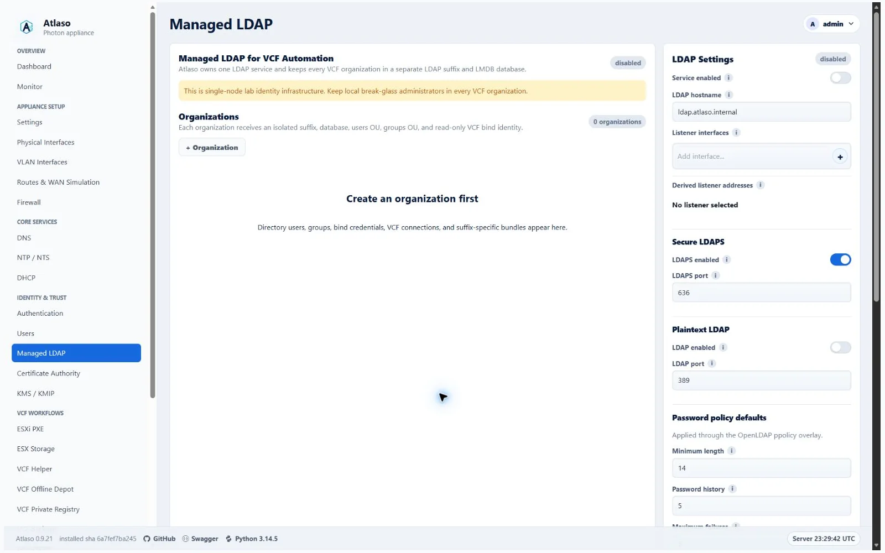
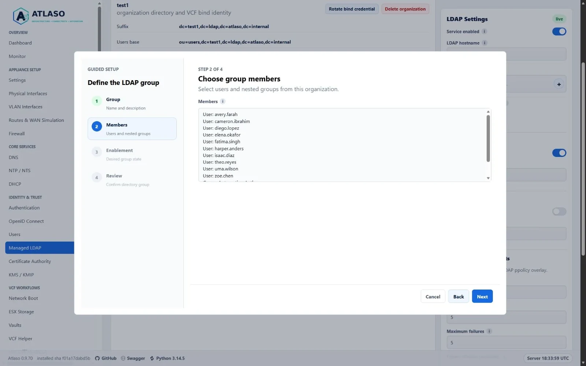
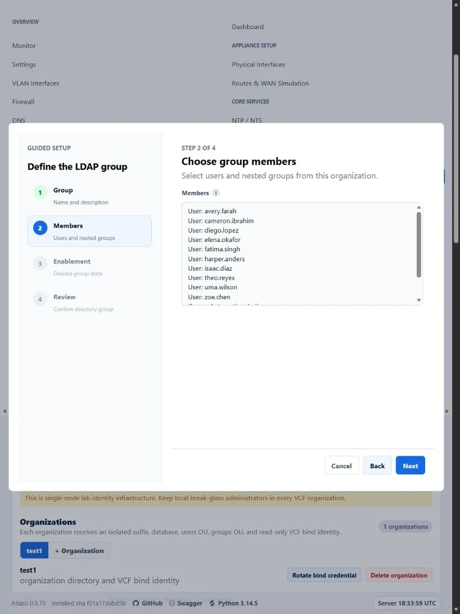
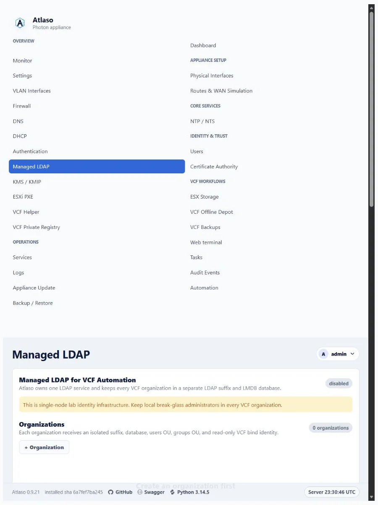

# Managed LDAP for VCF Automation 9.1

Atlaso can operate a single OpenLDAP 2.6 service for VCF Automation while keeping each VCF organization in a separate
LDAP naming context and LMDB database. This service is independent from Atlaso operator authentication: Atlaso sign-in
remains local in v1.

<!-- BEGIN GENERATED INTERFACE OVERVIEW -->
## Interface overview

This verified appliance view provides visual orientation before you begin.



*Figure: Managed LDAP in the verified clean-appliance desktop state.*

<!-- END GENERATED INTERFACE OVERVIEW -->

## Security boundary

- LDAPS is enabled by default on configurable TCP port 636 and uses a CA-managed certificate.
- Optional plaintext LDAP is disabled by default and has an independently configurable TCP port, defaulting to 389.
  Enabling it exposes credentials and directory data without transport encryption, so use it only on an isolated lab
  network when a client cannot use LDAPS.
- Privileged reconciliation uses local `ldapi:///` with SASL EXTERNAL through `atlaso-helper ldap`.
- The integrated Atlaso CA issues the `ldap:ldaps` certificate for the configured hostname and listener addresses
  whenever LDAPS is enabled.
- Firewall apply owns rules for each enabled LDAP/LDAPS port on selected addressed access or route interfaces and
  enabled VLANs. Management interfaces are not eligible LDAP listener targets.
- Each organization receives a separate suffix and database. Its generated VCF bind identity can read only that suffix.
- VCF bind secrets are encrypted with `ATLASO_SECRETS_KEY`. Choose an automatically generated password (the default)
  or a custom password when creating an organization or rotating its bind credential. Credential responses remain
  one-time for generated passwords; custom passwords are not returned, and normal organization reads never reveal them.
- User passwords are held only in process memory until global LDAP apply. Password plaintext and hashes are never stored
  in the application database, previews, tasks, or audit details.

The default organization layout is:

```text
dc=<organization>,dc=ldap,dc=atlaso,dc=internal
├── ou=users
├── ou=groups
├── ou=service-accounts
└── ou=system
```

## Directory behavior

The helper generates one MDB database per enabled organization and configures the `ppolicy`, `memberof`, and
referential-integrity overlays. Groups use DN-valued `member` attributes and may contain users or groups. Atlaso rejects
cross-organization members and direct or indirect group cycles before save and again during helper validation.

The default password policy requires 14 characters with uppercase, lowercase, number, special-character, and username
checks. Five failures lock a user for 15 minutes, and five previous passwords are retained. Expiry is disabled by
default because v1 has no end-user password-change portal. Administrators can stage password resets, enable or disable
users, and request an unlock; enforcement occurs only through global LDAP apply.

The Directory UI treats organizations like DNS zones: each organization is a tab and `+ Organization` opens a guided
wizard for its name, operator description, isolated naming context, and enablement. Users and groups use
wizard-backed Tabulator grids with bottom add rows. The grids fill the remaining desktop viewport and resize with the
panel or selected tab. Narrow layouts retain compact grid heights and keep horizontal scrolling inside each grid.
Opening a saved row returns to the same reviewed flow, while the Enabled column remains a direct edit for quick
desired-state changes. Row menus retain password reset, unlock,
membership, and deletion actions. Group membership presents the selected organization's current users and eligible
nested groups. New users and groups default to Enabled before review; turn off Enabled to save a disabled entry.
Editing preserves the entry's saved state. User creation can stage a password or postpone it;
non-grid user and group creation returns to the selected organization using its saved identity. Enabling an account
without an applied or staged password causes LDAP apply validation to stop before host mutation.

Rapid organization-tab selections and browser back or forward navigation follow the latest selection. A superseded
partial response cannot replace the selected organization, its URL, or its directory content. Returning to the initial
queryless Managed LDAP URL restores the server-default organization through the same ordered load path.

The one-time VCF bind credential opens with its **Bind password** help collapsed and focus on **Done**, leaving the
credential text unselected until the operator deliberately copies or saves it.

If browser JavaScript is unavailable, **Rotate bind credential** retains the server-submitted generated-password flow.
Custom password selection requires the guided browser wizard.

To use a password already stored in your secret manager, select **Custom password** in the organization wizard's bind
credential step, enter it twice, and review the organization. Password entry fields appear only for **Custom password**;
switching to automatic generation hides and clears them. A successful custom rotation shows a confirmation status
with the organization name and the global Apply reminder. Custom bind passwords must satisfy the current Managed
LDAP password policy for the `vcf-bind` account. Review shows the password mode without showing the value. Cancelling
or completing the wizard clears the password fields. After a rejected submission, the wizard reopens with its error,
retains non-secret organization fields and the chosen mode, and asks you to enter the password again. Use the
organization's bind-credential rotation workflow to
replace a saved password; editing organization metadata does not rotate it. Update every external directory consumer
with the replacement credential and submit the reviewed global LDAP Apply before testing the new bind.

API clients may supply the optional write-only `bind_password` when creating an organization or rotating its bind
credential. Omit it to retain automatic generation; an explicitly empty or policy-invalid password is rejected without
changing the credential. Generated passwords retain their existing one-time credential responses; custom-password
responses omit the raw value. Keep request and response bodies out of client logs and store credentials as concealed
values in your secret manager.

**Generate test directory** asks for user and group counts, invents complete synthetic identities and memberships, and
shows generated passwords once; those passwords follow the same in-memory-only staging boundary as manually entered
passwords. The result changes the primary action to **Done**, which closes the modal and clears the one-time CSV from the
page. If Atlaso restarts before those passwords are applied, VCF Helper summarizes the affected users per organization
and **Recover missing passwords** generates replacement credentials in one operation with a new one-time CSV.

## vCenter OpenLDAP groups

Each organization also publishes `ou=vcenter-groups,<organization suffix>` during global LDAP Apply. These separate
entries use RFC4519 `groupOfUniqueNames` and DN-valued `uniqueMember`, matching the native OpenLDAP schema mapping
inspected on vCenter Server 9.1.1. [Broadcom KB316480](https://knowledge.broadcom.com/external/article/316480) specifies
the same schema for its listed versions through 8.x; that article alone does not establish 9.x interoperability.

The original `ou=groups` entries retain `groupOfNames/member`, their existing `entryUUID`, and the `memberOf` overlay
used by VCF Automation. The vCenter copies receive their own server-issued `entryUUID`, retained across ordinary
membership edits and repeated Apply. Atlaso does not combine conflicting structural classes or replace the original
groups. Group deletion, disablement or renaming removes the corresponding old projection during Apply; recreating a
deleted DN produces a new identity, so review external role assignments afterward. Recovery exports include both
subtrees and their UUIDs; importing an older archive adds the missing projection on the next global LDAP Apply.

To configure a vCenter OpenLDAP identity source:

1. Submit the organization's pending changes through global **Review appliance changes**, including Managed LDAP and
   its required dependencies. Do not create or modify directory entries manually.
2. Use verified LDAPS and the organization's read-only bind identity. Retain existing local break-glass access.
3. Set the users base to `ou=users,<organization suffix>` and the groups base to the **vCenter groups base** shown in
   Managed LDAP. Keep VCF Automation's existing **VCF groups base** unchanged. Searching from the suffix root can
   expose both representations; use the consumer-specific base.
4. Verify direct-group discovery in the permission-principal picker and independently with
   `UserDirectory.RetrieveUserGroups` with group search enabled. Grant a test group a scoped role and verify that a
   direct member can use that role. A successful user login alone does not verify group discovery or authorization.

| Membership behavior | Contract and verification boundary |
| --- | --- |
| Direct users | vCenter copies reference original user DNs through `uniqueMember`; native discovery and role use require version-specific acceptance. |
| Nested groups | Copies reference copies in the same organization. No flattening occurs; verify native nested authorization separately from direct membership. |
| VCF `memberOf` | Original direct backlinks remain unchanged; copies do not add a second set of backlinks to users. |
| OIDC mapped groups | Atlaso's existing cycle-safe direct and nested desired-state graph remains authoritative. |

Changing the vCenter search base is an external configuration action. Review it separately and preserve existing
sources and permissions until the replacement path has passed the checks above.

## VCF Automation integration

Open the **Managed LDAP for VCF** tile on the VCF Helper page for both manual bundles and the guided inspection,
configuration, and verification workflow. The Managed LDAP page remains focused on directory service settings,
organizations, accounts, and groups. Encrypted LDAP recovery is integrated into Backup / Restore as a separate
LDAP-specific archive.

The VCF Helper presents organization selection, tenant connection, transient trust details, and the inspect-or-configure
choice as separate reviewed wizard steps. Synthetic directory generation similarly separates organization selection,
directory sizing, and the one-time credential warning before creation.

Every organization can download a manual ZIP bundle containing the selected VCF LDAP endpoint, root CA PEM when LDAPS is
used, search bases, bind DN, VCF Automation 9.1 JSON, and operator instructions. The bind password is intentionally
separate. Generated VCF settings prefer LDAPS whenever it is enabled; plaintext LDAP is used only when LDAPS is disabled
and LDAP is enabled.

The guided workflow requires TLS 1.2 or newer while probing and pins the VCF Automation TLS SHA-256 fingerprint. The
fingerprint confirmation remains the trust decision; Atlaso does not silently replace it with ordinary CA
verification. The workflow reads current organization LDAP settings, requires explicit replacement approval, writes
`settingsSource=DEFINED`, tests LDAP, and verifies that VCF can find at least one user and group. Administrator
credentials are transient and are not stored.

The VCF 9.1 mapping includes:

```json
{
  "userAttributes": {
    "serviceAccount": "employeeType"
  }
}
```

Atlaso does not import LDAP groups into VCF or assign VCF organization roles. Complete those steps in VCF Automation and
retain local break-glass administrators.

## OIDC organization and group use

Managed LDAP can also supply identities to Atlaso's constrained OIDC provider. A bound OIDC client uses only its
configured enabled organization and does not show an organization selector. An unbound client requires the user to
choose **Local** or one currently enabled organization; duplicate usernames across organizations are therefore never
used to infer a source.

The Authentication page maps selected managed LDAP groups to external OIDC group names. Atlaso evaluates current enabled
direct and nested membership through the same cycle-safe group graph used by the directory model. Organization mappings
are defaults; a compatible client-specific mapping replaces the default for the same LDAP group. Only mapped external
values are emitted when the client receives the `groups` scope. Raw LDAP group names, DNs, suffixes, listener details,
disabled groups, and unmapped groups remain private.

## Apply and recovery

The `ldap` apply unit stages secret-bearing JSON at `/var/lib/atlaso/apply/ldap/atlaso-ldap.json` with mode `0600`. The
file exists only for the constrained helper execution window. Atlaso and `atlaso-helper` remove it after success,
validation failure, or apply failure, and application startup removes stale input after an interrupted process. Raw
secrets remain excluded from previews, baselines, task payloads, logs, audits, and test output. When LDAP-related CA,
DNS, or firewall desired state changes, global appliance apply submits the changed dependency units together, including
when NTS server selection adds Certificate Authority to the task.

Normal settings backup contains LDAP metadata but no bind secrets or password hashes. Use the separate
passphrase-encrypted LDAP recovery export to preserve `slapcat` data. Recovery import decrypts and validates the archive
in memory, then stages it for the next global LDAP apply. A restart before apply requires the archive and passphrase
again. A rejected or failed settings-archive restore leaves the staged recovery metadata and in-memory payload intact;
only a successfully committed settings restore or factory reset clears it.

<!-- BEGIN GENERATED ADDITIONAL SCREENSHOTS -->
## Additional verified states

These captures show responsive layouts and useful operational states referenced by this page.

### Ldap: Groups



*Figure: Managed LDAP group wizard populated with selectable users and nested groups.*



*Figure: Managed LDAP group Members step in the verified narrow viewport.*

### Managed LDAP



*Figure: Managed LDAP in the verified clean-appliance responsive state.*

<!-- END GENERATED ADDITIONAL SCREENSHOTS -->
