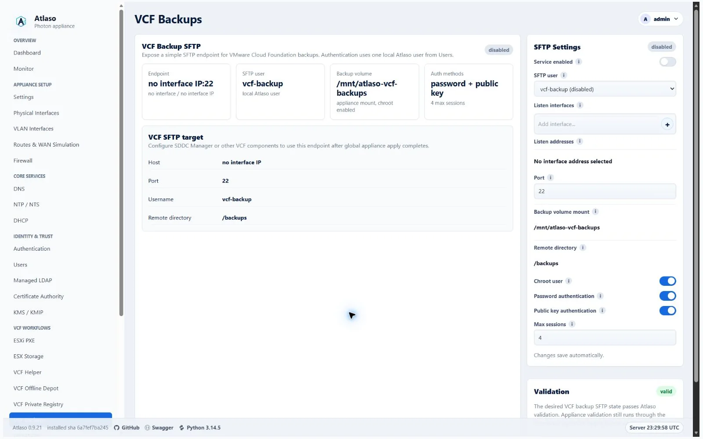
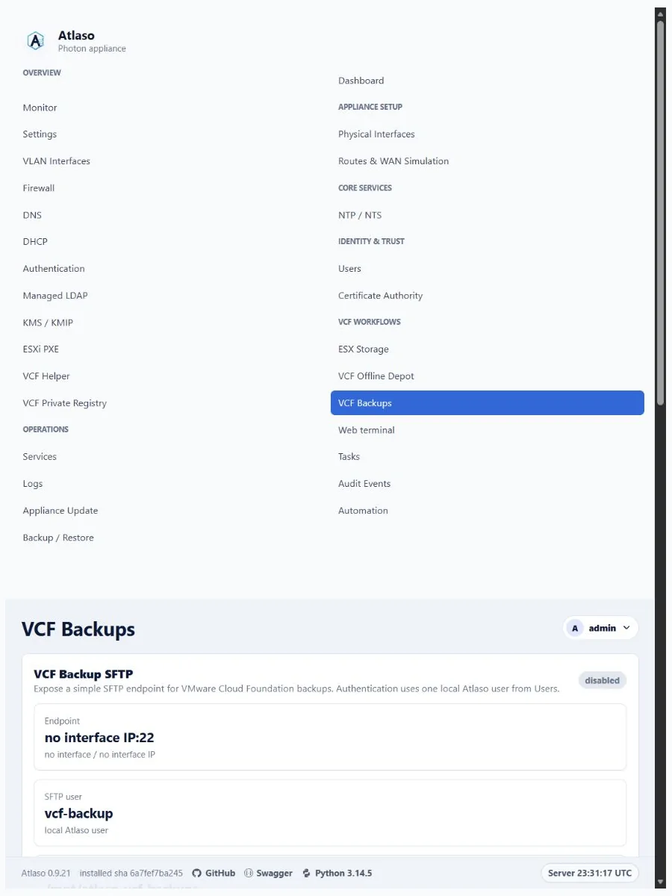

# VCF backups

Use the **Backup** tab in **VCF Helper** at `/ui/management/vcf-helper`, then select **Configure VCF Backup**.
The wizard uses native VCF 9.1.x APIs to inspect supported components, review a destination and schedule, configure the
native schedule, and run one initial backup task. The native product owns recurring runs after configuration. For the
separate Atlaso SFTP receiver settings, see [receiver prerequisites](#prepare-the-atlaso-sftp-receiver) below or go to
`/ui/management/vcf-backups`.

<!-- BEGIN GENERATED INTERFACE OVERVIEW -->
## Interface overview

This verified appliance view provides visual orientation before you begin.

*Figure: VCF Backups in the verified clean-appliance desktop state.*

<!-- END GENERATED INTERFACE OVERVIEW -->

## Prepare the Atlaso SFTP receiver

The wizard is enabled only when the Atlaso **VCF Backups** SFTP service is ready. Configure the receiver at
`/ui/management/vcf-backups`, then apply its current settings before returning to VCF Helper. The selected local SFTP
user must be enabled, have its current Photon OS password synchronized by **Local Users**, and have no pending password
change. The receiver also requires the fixed `/mnt/atlaso-vcf-backups` volume, chroot and password authentication, the
applied VCF Backups configuration, an active `sshd` listener, and the appliance's required public SSH host keys. The
wizard checks the mount, rendered applied configuration, and live listener before each workflow action; saving intent
alone is not enough. Apply **Local Users** first when the selected account or password needs synchronization, then apply
**VCF Backups** through the shared [Appliance Apply](../operate/appliance-apply.md) workflow.

The SFTP server must present the ECDSA key used for fingerprint confirmation and advertise a modern RSA-SHA2 host-key
algorithm as well as an ECDSA host-key algorithm. These are separate requirements: an ECDSA fingerprint alone does not
prove that SSH negotiation can complete. See Broadcom [KB 438943](https://knowledge.broadcom.com/external/article/438943)
for the VCF 9.x SFTP fingerprint and algorithm requirements.

Fleet LCM may report the receiver's RSA fingerprint. Atlaso matches the reported fingerprint to a locally verified
RSA or ECDSA public key before reviewing or submitting it; it does not trust the remote thumbprint alone.

## Inspect and review VCF sources

1. Open **VCF Helper → Backup → Configure VCF Backup**. This is an administrator-only workflow. For Fleet LCM,
   provide the VCF Operations endpoint and choose an existing **Vault** credential or enter Operations credentials for
   this request.
2. Use **Read TLS fingerprint** for VCF Operations. Compare the SHA-256 certificate fingerprint with a trusted
   out-of-band source and confirm that exact Operations server before submitting credentials. After login, Atlaso reads
   `GET /suite-api/api/integrations/services` and requires exactly one `VCF_FLEET_LCM` descriptor. Review its advertised
   FQDN, port, base path, certificate, version, and service key in discovery and review. Atlaso uses that discovered
   Fleet service through Operations with a service JWT and the pinned certificate. The descriptor is bound to the
   operation; identity or certificate drift requires a fresh inspection. You do not enter a separate Fleet LCM endpoint
   or confirm a second Fleet certificate. The SSH host key shown later belongs to the Atlaso SFTP receiver.
3. In **Discovery**, select **Add another source** to add optional direct SDDC Manager, vCenter, or NSX connections.
   Confirm each direct server's TLS fingerprint before submitting credentials. Select supported components and inspect
   displayed **Coverage** and warning details. The workflow accepts native API versions in the VCF 9.1.x range; it
   refuses unsupported or ambiguous source versions or identities before native writes.
4. Set the destination password and backup-encryption passphrase using the offered saved **Vault** secret references.
   The wizard requires a vCenter-compatible passphrase of 12–20 visible ASCII characters, including uppercase and
   lowercase letters, at least two digits, and a symbol. This policy is stricter than vCenter's eight-character
   minimum. Choose a passphrase held in your approved recovery escrow: Atlaso cannot reveal it after configuration.
   Source API credentials may be manual and request-local or resolved from a Vault entry. Secret values never appear in
   the page, durable task settings, logs, or audit details; durable workflow state stores only bounded source and Vault
   references.
5. Edit the schedule and retention values supported by the discovered native product. For **Operations recurring
   backups**, the default **Preserve existing schedule** keeps the reviewed full and incremental recurrence, including
   its exact time and timezone. When no schedule exists, this choice leaves recurrence disabled. Choose **Daily
   recurring backups** to create a daily full-backup schedule at the selected UTC time, or **Disable recurring backups**
   to explicitly disable both full and incremental recurrence. Every choice still starts one initial backup after
   configuration. These recurrence choices currently apply to VCF Operations; direct appliance schedules retain their
   existing daily/interval controls. SDDC Manager uses UTC; vCenter uses its configured appliance timezone. The
   state-change control applies only where that native API supports it. Retention settings are product-specific: NSX
   has no native retention policy, and SDDC Manager exposes separate most-recent, hourly-day, and daily-day values.
   SDDC Manager backup settings also affect the NSX destination and cadence for co-managed NSX appliances. Configure
   SDDC Manager first, then inspect and review a direct NSX connection in a fresh operation; the wizard blocks their
   combined execution. Fleet LCM stores a shared schedule for the entire SDDC-LCM group, so the wizard requires every
   eligible component in a selected group together.
6. Select **Next** to open **Review and configure**, then inspect the exact current and proposed native settings,
   selected components, destination, coverage gaps, and side effects. Review existing schedules before approving
   replacement. The signed review is bound to the inspected source revisions, TLS fingerprints, current receiver,
   component selection, policy, and Vault references. It expires after ten minutes and can be used once; changing an
   input requires a fresh inspect or review.
7. Confirm the recovery-passphrase escrow, approve any schedule replacement, and select **Configure and start initial
   backup**. This applies the reviewed native settings and submits one initial native backup task. Atlaso does not
   install a repeating Atlaso-side schedule; the native VCF product owns recurrence.

### Coverage and native API limits

The component list and review keep native API coverage gaps visible. For example, Fleet LCM components are selectable
only when Fleet reports `backupAllowed=true`; a Fleet schedule applies to its whole eligible SDDC-LCM group. An SDDC
Manager connection can configure the SDDC Manager backup API, but vCenter and NSX resources it discovers are explicitly
marked for their separate direct connections. The vCenter Recovery API does not expose an SFTP SSH fingerprint field,
so the appliance's locally confirmed ECDSA key cannot be bound in the native vCenter schedule. NSX exposes no native
retention-policy setting; an SDDC Manager side effect can update co-managed NSX destination and cadence without adding
retention enforcement. Any image-only or otherwise unsupported components stay visible as coverage gaps and are not
claimed as configured or verified.

Fleet integration follows the [VCF 9.1 Fleet LCM OpenAPI contract](https://github.com/vmware/vcf-api-specs/blob/98086628de07a7480141873ea5b8a53bb113e98f/specifications/fleet-lcm/fleet-lcm-openapi.yaml).
Broadcom documents that NSX retention settings are not honored in VCF 9.0 and 9.1 in [KB 442696](https://knowledge.broadcom.com/external/article/442696/nsx-backup-retention-settings-in-sddc-ma.html).
Atlaso does not claim native NSX retention; plan and verify any external retention process separately.

## Verify tasks and recover interrupted work

After task authorization, Atlaso prepares the reviewed directories on the pinned SFTP receiver before native
destination validation. All native preflight checks must succeed before any appliance backup settings are changed.

Follow the operation under [Tasks](../operate/tasks.md). A task is successful only when the native backup operation
reports success and Atlaso observes fresh, non-empty files on the applied SFTP receiver for every selected component.
The task records artifact paths, sizes, and modification times; a native success state without matching new receiver
files is not completion evidence.

Configuration and initial-backup verification each have a one-hour bound. Temporary HTTP 503 responses during
read-only status checks keep the recorded native reference and continue polling within that bound. Native writes are
never automatically repeated.
Fleet polling can refresh an expired API token once through Operations after HTTP 401. The discovered service identity
must still match the reviewed service before the same read is retried.

If a task fails, the process restarts, or the native write outcome is uncertain, use **Reconcile (read-only)** on that
operation. The **Backup Operations** list shows your admitted runs; double-click a row to open its status. Alternatively,
select **Resume Existing Backup Operation**, enter the operation ID, and select **Load status**. This opens a standalone
status popup, without configuration steps. Closing it or the browser does not stop an admitted backup or reconciliation.
Read-only reconciliation is admitted promptly and continues in the background; the popup shows queued, running,
completed, or failed status independently of the original backup outcome. Reopening the operation loads that durable
status. Repeated clicks while reconciliation is active reuse the same run. If Atlaso restarts during reconciliation,
the read is marked interrupted and can be requested again; native work is never replayed. Manual source passwords
remain only in that background invocation's memory and must be entered again for a later read.
The status view distinguishes verified backup artifacts from whether the current native policy still matches the
reviewed configuration. A later policy change does not erase a previously successful backup; it appears as a separate
read-back warning. Reconciliation rereads native settings
and the recorded backup status; it never resubmits
configuration or starts another backup. The scheduler reservation remains held while the outcome is unresolved. An unresolved
`dispatch_pending` operation without a native task reference cannot be explicitly closed or have its reservation
released until a verifiable native outcome is available. Reconciliation may adopt success only after native completion
is confirmed and fresh receiver files are matched to every selected component. Then inspect a fresh plan before
attempting another configuration. Do not retry an uncertain native write from the original review.

Fleet restore-point locations may be SFTP URLs. Atlaso accepts them for file verification only when their server,
port, account, and directory match the reviewed receiver. Fresh non-empty files are still required for every component.

If the recorded checkpoints prove that no native write was attempted, you can explicitly finish recovery even when
the reviewed receiver credentials no longer work. This releases the operation's reservations without contacting the
receiver or changing a native backup policy. Fresh artifact verification still requires receiver authentication.
If the receiver changed or is unavailable, reconciliation can still report native outcomes. It keeps artifacts
unverified and permits explicit closure only after recorded native tasks reach verified terminal states.

Validate the workflow in a non-production VCF 9.1.x environment and separately test the resulting backup's
documented restore procedure before relying on it for disaster recovery.

<!-- BEGIN GENERATED ADDITIONAL SCREENSHOTS -->
## Additional verified states

These captures show responsive layouts and useful operational states referenced by this page.

### VCF backups

*Figure: VCF Backups in the verified clean-appliance responsive state.*

<!-- END GENERATED ADDITIONAL SCREENSHOTS -->
