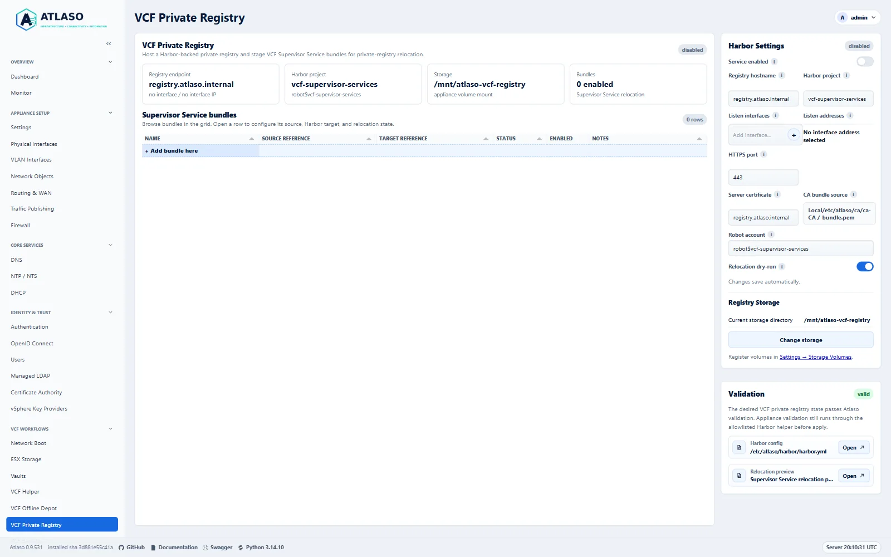
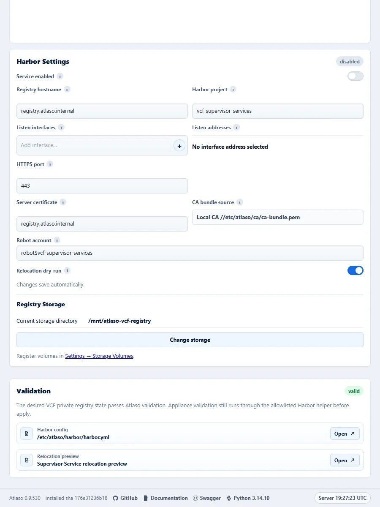
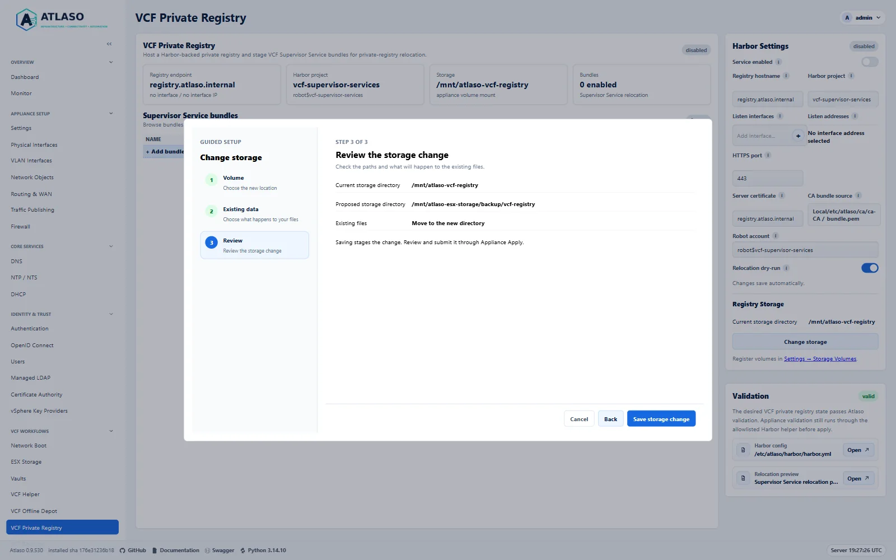

# VCF Private Registry

Open **VCF Private Registry** to configure the appliance-hosted registry endpoint, storage, listener, and access
boundaries.

<!-- BEGIN GENERATED INTERFACE OVERVIEW -->
## Interface overview

This verified appliance view provides visual orientation before you begin.

*Figure: VCF Private Registry in the verified clean-appliance desktop state.*

<!-- END GENERATED INTERFACE OVERVIEW -->

## Configure the registry

1. In **VCF Private Registry**, choose **Change storage** to open the shared storage wizard. Select a registered volume.
   Atlaso appends `vcf-registry` to its mount path and derives the storage directory. **Appliance default** uses
   the installation storage. A volume can serve one VCF storage assignment at a time. Register volumes in
   [Settings → Storage Volumes](../operate/appliance-settings.md#register-storage-volumes).
2. When changing directories, choose whether to **Move**, **Leave**, or **Delete** existing files. Saving stages the
   storage change for Appliance Apply. Review the current and proposed directories and selected action
   under **Review appliance changes**. Delete requires typing the exact confirmation shown there. Storage is applied
   independently of registry endpoint and bundle configuration.
3. Confirm the intended listener interface and access needed by approved lab clients.
4. Resolve validation errors and inspect the rendered service preview.
5. Submit the desired changes through [Appliance Apply](../operate/appliance-apply.md).

Keep credentials, authenticated image references, and private certificate material out of documentation and task
output.

## Verify and roll back

After **VCF Private Registry Storage** succeeds, confirm the storage section shows the new current directory. On an
appliance serving an active registry, also verify that an approved client can still read the expected content. To switch
back to a directory whose files you chose to leave in place, select it in the wizard and submit a new storage Apply.

After applying listener or trust changes, confirm the endpoint presents the expected certificate and an approved
client can perform the required registry operation.

<!-- BEGIN GENERATED ADDITIONAL SCREENSHOTS -->
## Additional verified states

These captures show responsive layouts and useful operational states referenced by this page.

### VCF Private Registry

*Figure: Open the storage wizard from Harbor Settings in the narrow layout.*

*Figure: Review and stage the storage change independently of the Harbor settings.*

<!-- END GENERATED ADDITIONAL SCREENSHOTS -->
